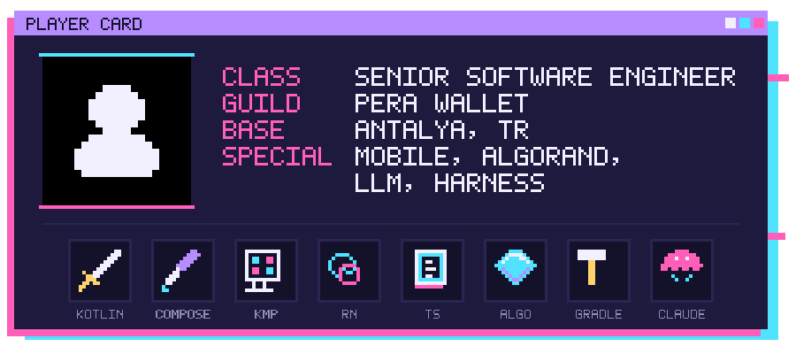
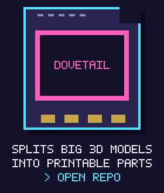
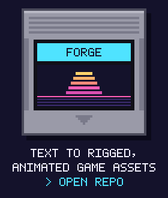
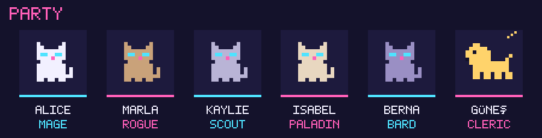

  <picture></picture>

  <picture></picture>

  
  

<!-- Cartridges without a public repo. Move them into the row above to show them.

  <picture></picture>
  <picture></picture>
  <picture></picture>
  <picture></picture>

-->

<!-- Party (hidden for now)

  <picture></picture>

-->

  <picture>
    <source media="(prefers-color-scheme: dark)" srcset="https://raw.githubusercontent.com/mitsinsar/mitsinsar/output/snake-neon-dark.svg">
    
  </picture>

