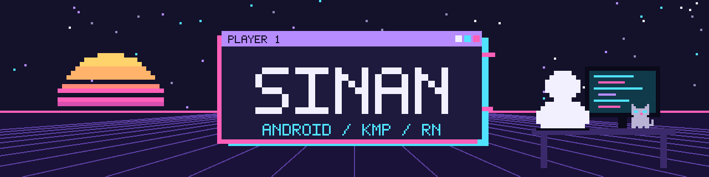
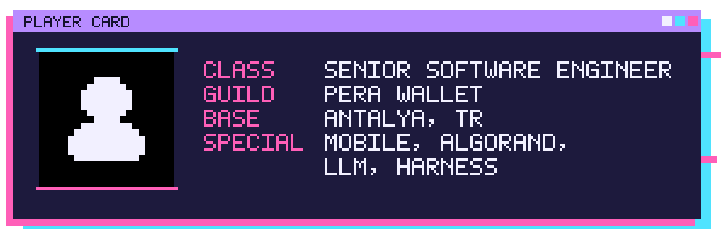
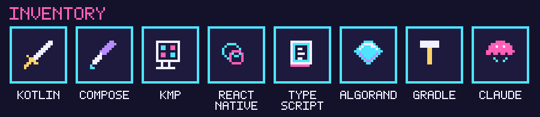
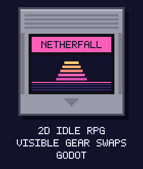
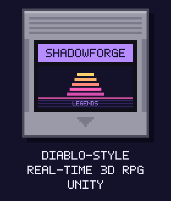
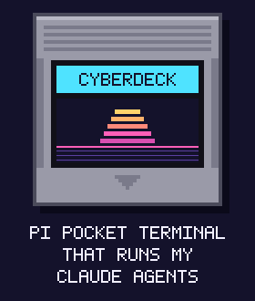
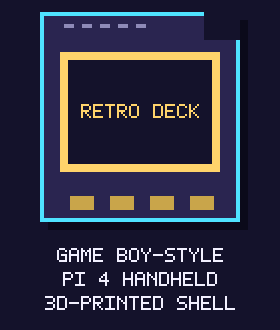

  

  

  

  

  
  

<!-- Cartridges without a public repo. Move them into the row above to show them.

  
  
  
  

-->

  

  <a><picture>
    <source media="(prefers-color-scheme: dark)" srcset="https://raw.githubusercontent.com/mitsinsar/mitsinsar/output/snake-neon-dark.svg">
    
  </picture></a>

